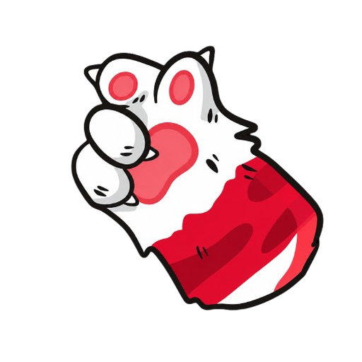
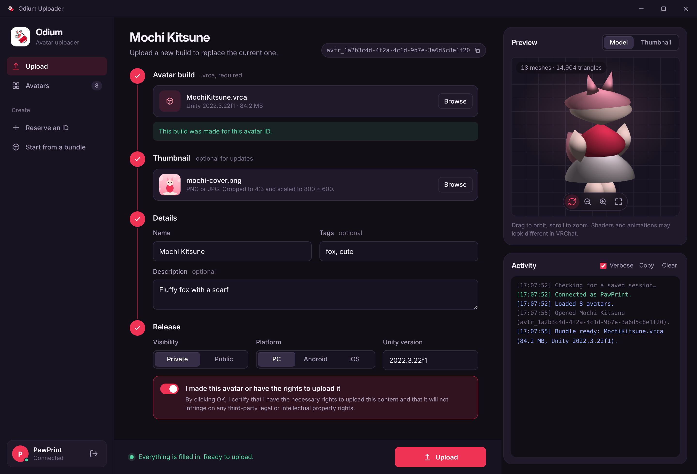
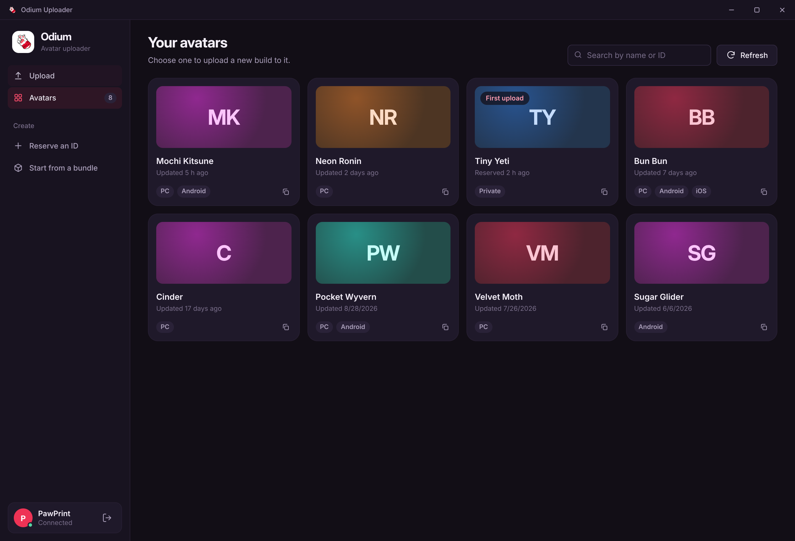
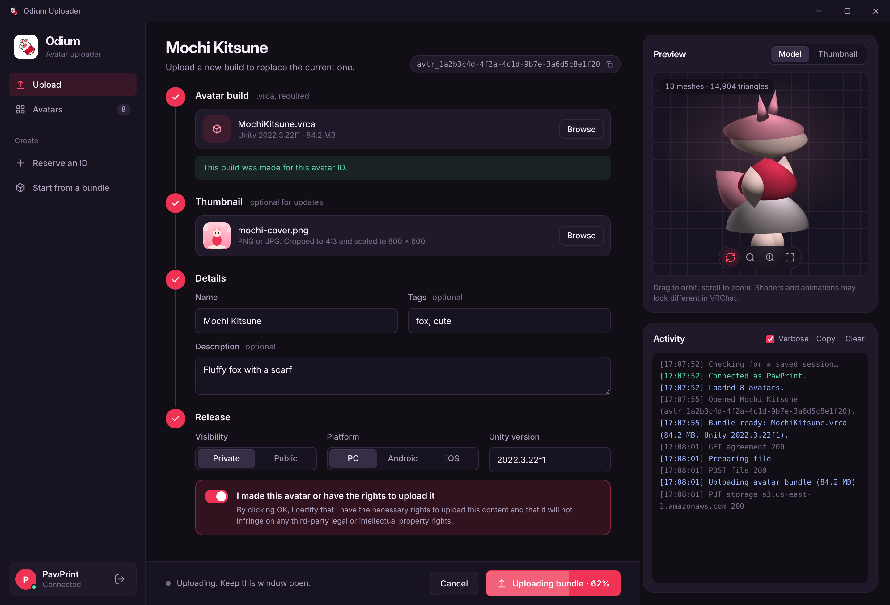
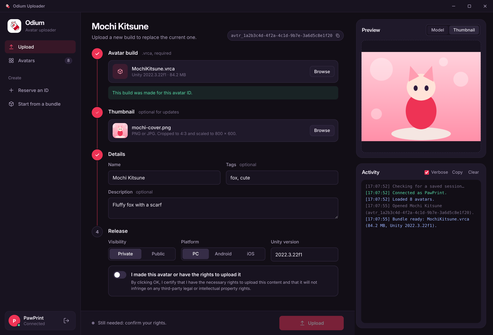
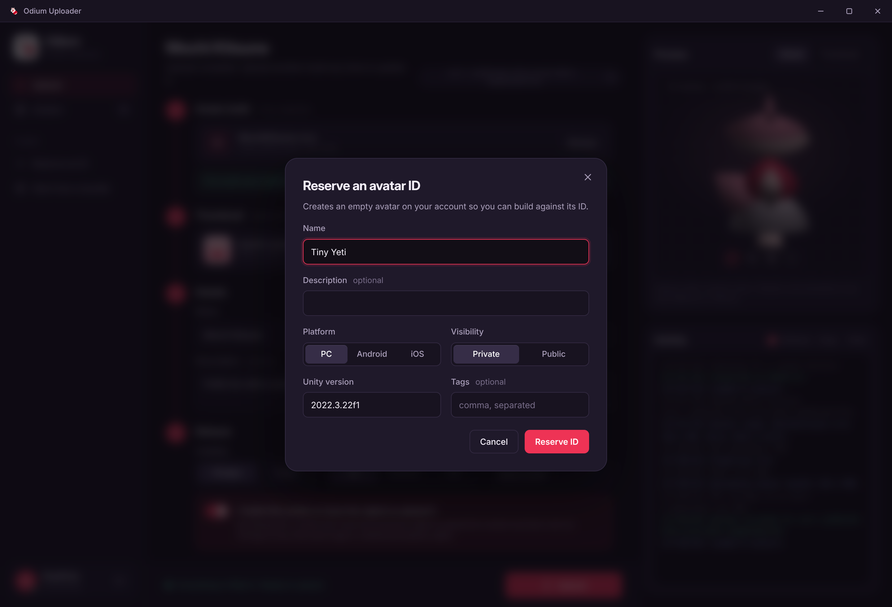
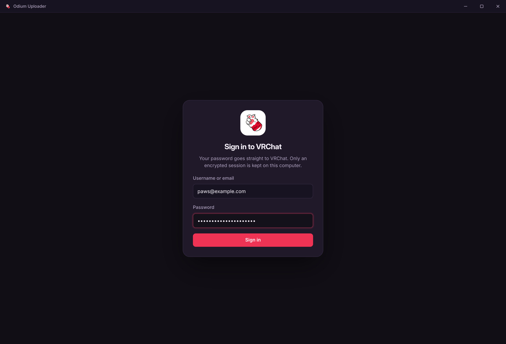
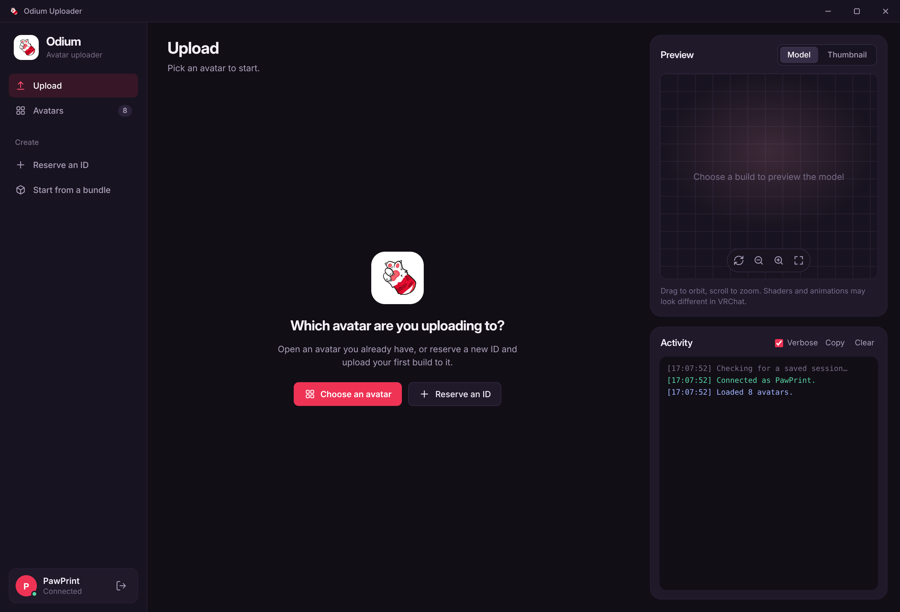

<div align="center">



# Odium Uploader

**Upload your own VRChat avatar and world builds without opening Unity.**

Pick a `.vrca`, check it in a live 3D preview, and publish it to your avatar in one click.

<br>



</div>

<br>

## Highlights

- **Direct upload.** Ports the upload flow from the VRChat SDK (`VRCApi.cs`, 3.10.x): copyright agreement, file records, rsync signature, and simple or multipart storage upload with live progress.
- **Worlds too.** Upload a `.vrcw` to one of your worlds, or create a new world from a build. Odium uses the `wrld_` ID the SDK baked into the build, refuses a build made for a different world, and sets maximum and recommended capacity. New worlds start private, as they do with the SDK.
- **3D preview before you publish.** Reads the Unity bundle itself and draws meshes and textures in WebGL, including Unity's Crunch-compressed textures (DXT1, DXT5, ETC, ETC2), plus uncompressed, DXT1, DXT5 and BC7 textures.
- **Blueprint ID check and rewrite.** Compares the avatar ID baked into the build with the avatar you are uploading to, and patches it in a temporary copy when they differ. Only the blocks that hold the ID are re-encoded; the header, hash, flags and every other block stay byte-for-byte as the SDK wrote them. Building with the right ID in Unity is still the safest route.
- **Reserve IDs and start from a bundle.** Create an avatar record first, or let Odium read the ID from a build and set the record up for you.
- **Careful with your account.** Two-factor sign-in, an honest User-Agent, and a session that is only saved when your OS can encrypt it.

## Getting started

You need [Node.js](https://nodejs.org) 18 or newer.

```bash
npm install
npm start
```

```bash
npm test          # bundle, signature, Crunch, BC7 and world-upload checks
```

### The workflow

1. In Unity, build your avatar with the VRChat SDK to get a `.vrca`. If you want, reserve an ID in Odium first and paste it into the avatar's PipelineManager.
2. Open Odium and sign in.
3. Choose the avatar to upload to, then pick the build and a thumbnail.
4. Name it, confirm that you have the rights to upload it, and press **Upload**.

## A tour

<table>
  <tr>
    <td width="50%">
      
      <br><b>Avatar browser</b><br>
      Every avatar on your account as a card, with platforms and last update. Search by name or ID.
    </td>
    <td width="50%">
      
      <br><b>Live progress</b><br>
      The upload button fills as the file goes up. Verbose activity shows each API and storage call.
    </td>
  </tr>
  <tr>
    <td width="50%">
      
      <br><b>Thumbnails</b><br>
      Images are cropped to 4:3 and scaled to 800 × 600, the same as the SDK does.
    </td>
    <td width="50%">
      
      <br><b>Reserve an ID</b><br>
      Create an empty avatar on your account and build against its ID.
    </td>
  </tr>
  <tr>
    <td width="50%">
      
      <br><b>Sign in</b><br>
      Your password goes straight to VRChat. Two-factor codes (app, email, recovery) are supported.
    </td>
    <td width="50%">
      
      <br><b>Start</b><br>
      With nothing selected, Odium asks which avatar you are uploading to.
    </td>
  </tr>
</table>

## How it works

```
 .vrca bundle ──► read header, find avtr_ ID ──► rewrite ID in a temp copy if needed
                                                      │
 thumbnail ──► crop 4:3, scale 800×600                │
                                                      ▼
   agreement ► file record ► rsync signature ► upload (simple / 100 MB parts) ► finish
```

- **Starting from a bundle.** Odium reads the avatar ID from UnityFS bundles (uncompressed and LZ4). It uses your existing record for that ID, or asks VRChat to create one.
- **Safety checks kept from the SDK.** The record's `authorId` must match the signed-in account, and the rights confirmation is never accepted for you.
- **Preview.** `src/unity/` parses serialized objects, meshes, materials and textures, and decodes block-compressed and Crunch textures in plain JavaScript. The renderer draws them with a small WebGL viewer.

### Worlds

Pick **Start from a bundle** and choose a `.vrcw`. Odium reads the world ID from the build: if you already own that world it opens it, otherwise the world is created on your account with that ID when you upload. World IDs are never rewritten. If the build was made for a different world, Odium tells you to open that world or rebuild. A build with no world ID gets a freshly generated one, with a warning that VRChat may reject it.

The upload follows the same steps as avatars (rights agreement, file records, signature, storage, finish), then creates or updates the world record with `assetVersion` 4 and the capacities you set. There is no 3D preview for worlds.

### Rewriting the pipeline ID

If the ID inside a bundle differs from the avatar you are uploading to, Odium patches it in place: only the blocks that contain the ID are re-encoded, using the same compression the SDK used (LZMA, LZ4 or LZ4HC; Odium ships its own encoders), and every other byte of the container is left untouched. Rewriting a 67 MB-unpacked avatar takes about 25 seconds.

### Pre-flight checks

Before uploading, Odium applies the same checks as the VRChat SDK: the bundle's real build platform must match the selected one, and its download and unpacked sizes must be within VRChat's limits (PC 200 MB / 500 MB, Android and iOS 10 MB / 40 MB). An avatar over the limits is accepted by the server but shown as **Security Checks Failed** and cannot be worn. After uploading, Odium also logs the performance rating and scan status that VRChat reports for the new package.

## Project layout

```
electron/            Main process
  main.js              App entry and VRChat client setup
  window.js            Frameless window
  session.js           Encrypted session storage
  thumbnail.js         4:3 crop and resize
  ipc/                 One module per area: auth, avatars, worlds, files, upload, window
  preload.js           The only bridge into the sandboxed renderer
src/
  vrchat/              API client (client.js) and rsync signature
  unity/               Bundle, mesh and texture parsing; Crunch and block decoders
renderer/            Sandboxed UI, no inline scripts or styles
  index.html
  css/                 Tokens, base, shell, components and one file per view
  js/                  One script per area, sharing a small `Odium` namespace
  assets/              Icon and bundled fonts
test/                Self-tests
tools/               Screenshot generator and its demo data
docs/images/         Screenshots used in this README
```

The renderer runs with `contextIsolation`, `sandbox` and a strict Content Security Policy. It can only reach the main process through the functions in `electron/preload.js`.

## Regenerating the screenshots

The screenshots come from the real renderer running in headless Chromium against made-up demo data (`tools/mock/api.js`), so no account or avatar is needed.

```bash
npm i --no-save playwright
npm run screenshots
```

## Status

Confirmed on real uploads:

- The copyright agreement, file records, multipart storage upload and finish.
- Crunch-compressed DXT textures in the preview, on a real avatar.

Not verified yet:

- **ETC and ETC2 Crunch textures.** The block decoders are tested, but there is no real sample file. If one fails, the preview shows the avatar untextured and says why.
- **BC7 textures.** The decoder matches a reference implementation bit-for-bit on every mode, but has not yet been run on a full avatar. BC6H (HDR) and ASTC are still unsupported and leave that texture blank in the preview.
- **Creating a record with a given ID** (Start from a bundle). VRChat may ignore the `id` field. If it refuses, Odium tells you to reserve an ID first.
- **LZMA-compressed bundles** cannot be scanned for their avatar ID yet. Paste it in instead.
- **World uploads.** Checked against a stubbed API only. Two details come from the SDK rather than a confirmed request: worlds use `assetVersion` 4, and no `worldSignature` is sent. Other third-party uploaders also leave it out, but whether VRChat requires it has not been confirmed.
- **Interface revamp.** Checked in headless Chromium with a stand-in bridge. Run it once in Electron to confirm the window frame, file pickers and uploads.

## Credits

Interface set in [Inter](https://github.com/rsms/inter) (SIL Open Font License). Odium is an independent tool and is not affiliated with or endorsed by VRChat Inc.
# odium-reuploader

